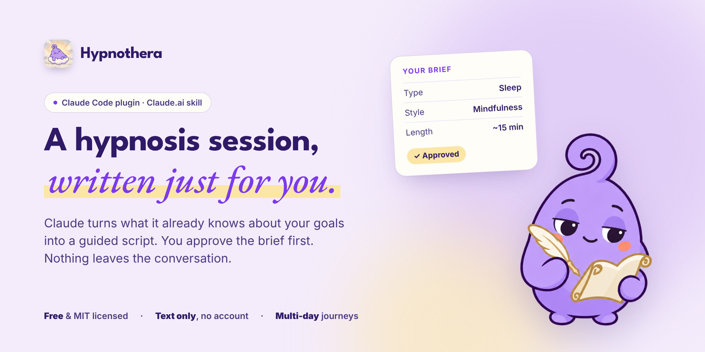
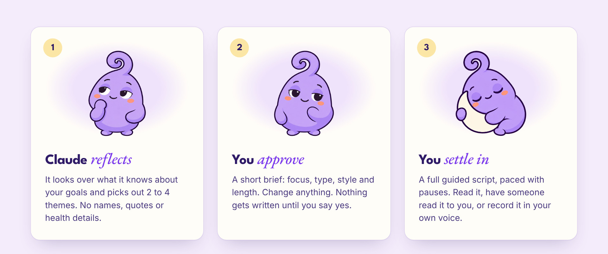
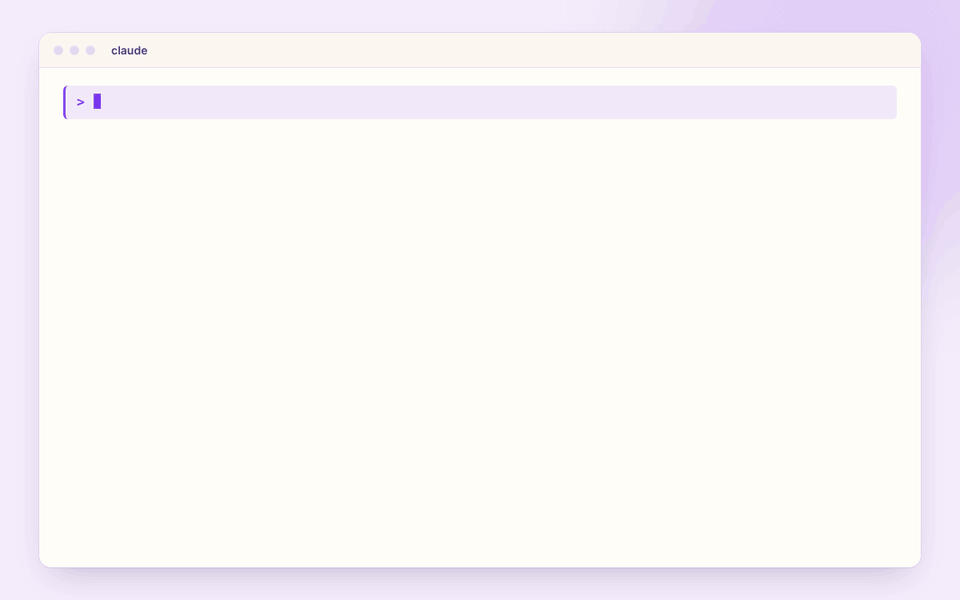

<p align="center">
  
</p>

<p align="center">
  <a href="#install"></a>
  <a href="#use-it-in-claudeai-or-any-agent"></a>
  
  <a href="LICENSE"></a>
  <a href="#private-by-design"></a>
</p>

<p align="center">
  <a href="#install"><b>Install</b></a> ·
  <a href="#how-it-works"><b>How it works</b></a> ·
  <a href="#see-it-in-action"><b>See it in action</b></a> ·
  <a href="#what-you-can-ask-for"><b>Session types</b></a> ·
  <a href="#private-by-design"><b>Privacy</b></a> ·
  <a href="https://hypnothera.ai"><b>hypnothera.ai</b></a>
</p>

<br>

Generic relaxation tracks are written for everyone, so they fit no one. Your assistant already knows the presentation you're dreading, the thoughts that keep you up, and the mornings you wish felt calmer. **Hypnothera Personal Session** turns that into a guided hypnosis script made for you, right in your conversation.

## Install

In Claude Code, add this repo as a marketplace, then install the plugin:

```
/plugin marketplace add La-Salida/hypnothera-claude-plugin
/plugin install hypnothera@hypnothera
```

Then ask:

> *Make me a hypnosis session based on what you know about me.*

That's it. No account, no API key, no setup.

### Use it in Claude.ai or any agent

The whole plugin is one skill file: [`skills/personal-session/SKILL.md`](skills/personal-session/SKILL.md). Upload it as a skill in Claude.ai, add it to a project, or drop it into any agent that reads skill files. To install it as a personal skill for Claude Code:

```bash
mkdir -p ~/.claude/skills/hypnothera-personal-session && \
curl -fsSL https://raw.githubusercontent.com/La-Salida/hypnothera-claude-plugin/main/skills/personal-session/SKILL.md \
  -o ~/.claude/skills/hypnothera-personal-session/SKILL.md
```

## How it works

<p align="center">
  
</p>

1. **Claude reflects.** It looks across what it knows about you (goals, stressors, upcoming events, sleep and focus patterns) and distills 2 to 4 themes.
2. **You approve a brief.** Focus, session type, style and length, in plain language. Ask for changes as many times as you like. Nothing long gets written until you say yes.
3. **You get your script.** Settling in, induction, deepening, suggestions built on your brief, and a close that either brings you back alert or lets you drift into sleep. Pauses are marked `[pause]`, paced at about 130 words a minute.

## See it in action

<p align="center">
  
</p>

<p align="center"><sub>Real output from the plugin in Claude Code, trimmed for length.</sub></p>

## What you can ask for

| Session | How it ends | Good for |
| :-- | :-- | :-- |
| 🌙 **Sleep** | You drift off. No count back up. | Racing thoughts, winding down, the night before something big |
| ☀️ **Morning** | Energized and composed | Starting the day steady instead of rushed |
| 🎯 **Mental rehearsal** | Alert and prepared | Interviews, presentations, exams, competitions |
| 🫧 **Standard** | Back fully alert | Deep relaxation, confidence, focus |
| ⏱️ **Short reset** | Back fully alert, in 5 to 10 minutes | A break between meetings |
| 🗺️ **Journey** | One day at a time, for 2 to 30 days | A personal goal, like better sleep, calmer mornings or a habit you've chosen to change |

Pick a style too: mindfulness, classic, conversational, storytelling or direct. Or let Claude choose.

**Try asking:**

- *"I have a job interview Friday. Write me a mental rehearsal for it."*
- *"Make me a 7-day journey for calmer mornings, based on what you know about me."*
- *"A 5-minute reset I can read between meetings."*
- *"Day 3 of my journey, please. Yesterday went well."*

## Private by design

- **Text only.** The skill doesn't call any server, create audio, or send anything to hypnothera.ai or anywhere else. Everything stays in your conversation.
- **No identifying details.** Briefs and scripts leave out names, employers, places, health conditions and verbatim quotes, so a script is safe to save, share or record.
- **You approve first.** Claude shows the brief before it writes anything long.
- **Open source.** The whole behavior is one readable [Markdown file](skills/personal-session/SKILL.md). MIT licensed.

## Use it well

Listen or read only in a safe, quiet place, never while driving or doing anything that needs your attention. You stay in control the whole time and can open your eyes whenever you like.

Hypnothera is a wellness and self-improvement tool for relaxation, focus, sleep quality and confidence. It is not a medical service. If you're dealing with a medical or mental-health condition, talk to a qualified professional; the skill won't write a script for that.

## Want it narrated?


The plugin writes text. [**Hypnothera**](https://hypnothera.ai), the app from the same team, turns sessions into narrated audio with background soundscapes: over **7,000 sessions** created, in **14 languages**, with **100+ voices**. It's a separate product, and nothing from your conversation carries over to it.

Already have a Hypnothera account and want Claude to create sessions and render their audio there directly? Use [**hypnothera-skill**](https://github.com/La-Salida/hypnothera-skill), which connects to your account through the Hypnothera MCP server.

## What's in this repo

```
.claude-plugin/
  marketplace.json       this repo is its own plugin marketplace
  plugin.json            plugin manifest
skills/personal-session/
  SKILL.md               the skill: everything the plugin does
assets/                  icon, logo and README images
```

Issues and pull requests are welcome. For anything else: [hello@hypnothera.ai](mailto:hello@hypnothera.ai).

<p align="center"><sub>MIT licensed · Made by the <a href="https://hypnothera.ai">Hypnothera</a> team</sub></p>
